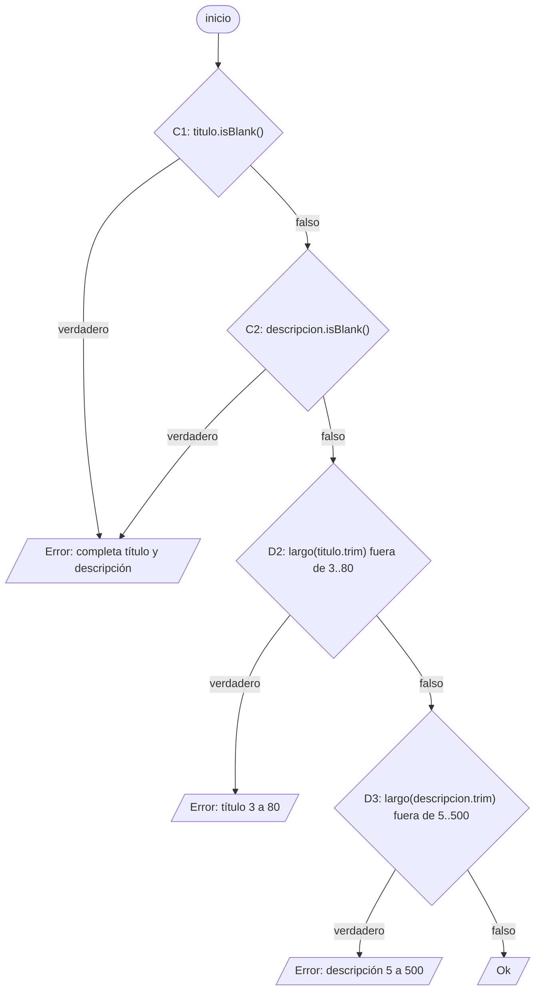
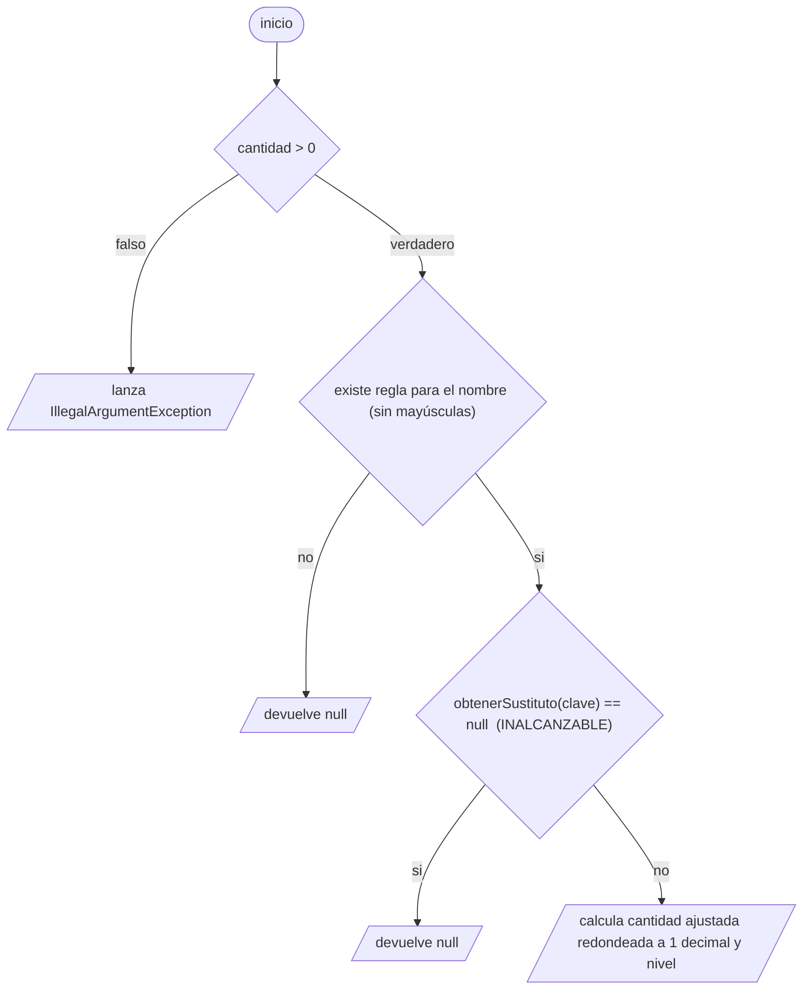
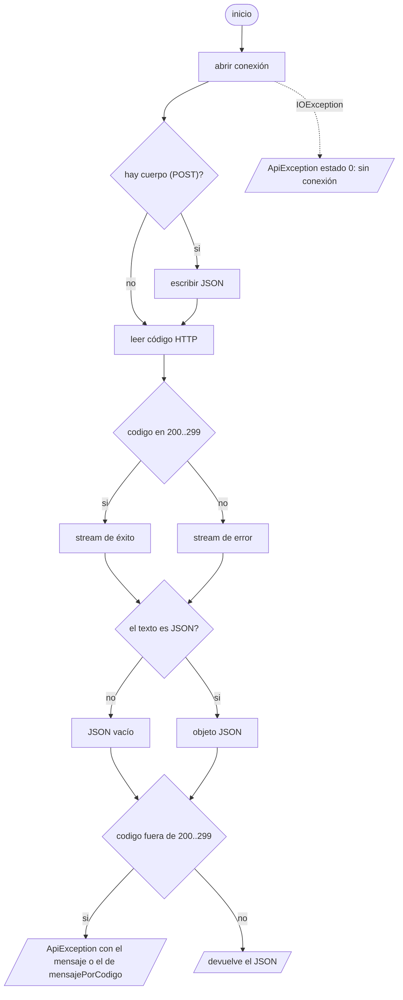

# Informe de auditoría White Box - RecipeStudio & KitchenSync (Práctica 11)

> **Cómo usar esta plantilla:** todo lo que dice `⟵ TU DATO` lo llenas tú con tu ejecución real. Lo marcado
> **[Referencia]** lo medí yo en un entorno aislado (sin tu celular, sin Render): sirve de guía y de comparación, pero **vuelve a medirlo**
> y pon tu número. Lo marcado **[Código]** sale de leer el código y no depende de tu máquina.

## 0. Datos de la ejecución (obligatorios)
| Campo | Valor |
|---|---|
| Estudiante / grupo | ⟵ TU DATO |
| Fecha de ejecución | ⟵ TU DATO |
| Commit evaluado (`git log -1 --oneline`) | ⟵ TU DATO (el mío al auditar: `b36fb08`) |
| Versión de la app | 1.0 (`versionName` en app/build.gradle.kts) |
| Dispositivo móvil / Android | ⟵ TU DATO |
| Equipo cliente de las mediciones / SO | ⟵ TU DATO |
| Servidor | Python 3 (`backend/server.py`) en Render, plan gratuito, `https://recipestudio.onrender.com` |
| Base de datos | Firebase Firestore (proyecto `recipestudio-e9730`) + Firebase Auth |
| Tipo de conexión | ⟵ TU DATO (WiFi / datos) |

## 1. Fase 1 - Inspección y análisis estático
**Módulos principales [Código]:** `network/` (KitchenApi, ServerConfig, GeminiSustitucion), `data/remote/` (FirebaseReportes, FirebaseProgreso),
`domain/` (SubstitutionCalculator, Receta...), `security/InputValidator`, `ui/` y `presentation/` (pantallas Compose),
`backend/server.py` (API REST), `firebase/firestore.rules` (seguridad de la base de datos).
**Funciones que se conectan al servidor:** `KitchenApi.call`, `RecipeStudioScreen` (conectar, estado, evento).
**Métodos de acceso a la BD:** `FirebaseReportes.crear / misReportes`, `FirebaseSoporte.*`, `FirebaseProgreso.guardar / cargar`.

**Salida de `analisis_estatico.py` [Referencia - vuelve a correrla]:**
```
=== ANÁLISIS ESTÁTICO - RecipeStudio ===

--- 1. Complejidad ciclomática (Python: exacta) - top 8 ---
  CC=15  _normalizar_url_publica      backend/server.py:57
  CC=12  evento                       backend/server.py:300
  CC=10  reportar                     backend/server.py:369
  CC=10  crear_sesion_qr              backend/server.py:236
  CC=9   _body                        backend/server.py:513
  CC=9   login                        backend/server.py:167
  CC=8   principal                    backend/server.py:200
  CC=7   _dispatch                    backend/server.py:549

--- 1. Complejidad ciclomática (Kotlin: aproximada) - top 8 ---
  CC~19  esHostPrivadoOlocal          app/src/main/java/com/recipestudio/kitchensync/network/ServerConfig.kt:13
  CC~19  mensajeFirebase              app/src/main/java/com/recipestudio/kitchensync/data/remote/FirebaseReportes.kt:40
  CC~13  EstacionesScreen             app/src/main/java/com/recipestudio/kitchensync/ui/EstacionesScreen.kt:32
  CC~11  SoporteScreen                app/src/main/java/com/recipestudio/kitchensync/ui/SoporteScreen.kt:36
  CC~11  analizar                     app/src/main/java/com/recipestudio/kitchensync/network/GeminiSustitucion.kt:33
  CC~10  SustitucionFotoPanel         app/src/main/java/com/recipestudio/kitchensync/ui/SustitucionFoto.kt:37
  CC~10  refrescarEstadoDesdeServidor app/src/main/java/com/recipestudio/kitchensync/presentation/ui/RecipeStudioScreen.kt:275
  CC~9   ResultadoIa                  app/src/main/java/com/recipestudio/kitchensync/ui/SustitucionFoto.kt:127

--- 2. Patrones de riesgo ---
  [2] Clave tipo API de Google
        backend/admin.html:68
        app/google-services.json:18
  [6] Operador !! (puede lanzar NullPointerException)
        app/src/main/java/com/recipestudio/kitchensync/presentation/ui/RecipeStudioScreen.kt:882
        app/src/main/java/com/recipestudio/kitchensync/presentation/ui/RecipeStudioScreen.kt:932
        app/src/main/java/com/recipestudio/kitchensync/ui/SoporteStaffScreen.kt:57
        app/src/main/java/com/recipestudio/kitchensync/network/KitchenApi.kt:99
        app/src/main/java/com/recipestudio/kitchensync/network/KitchenApi.kt:109
        app/src/main/java/com/recipestudio/kitchensync/network/KitchenApi.kt:115
  [1] URL http sin cifrar
        app/src/main/java/com/recipestudio/kitchensync/security/InputValidator.kt:67
  [20] catch genérico de Exception
        app/src/main/java/com/recipestudio/kitchensync/presentation/ui/RecipeStudioScreen.kt:326
        app/src/main/java/com/recipestudio/kitchensync/presentation/ui/RecipeStudioScreen.kt:357
        app/src/main/java/com/recipestudio/kitchensync/presentation/ui/RecipeStudioScreen.kt:366
        app/src/main/java/com/recipestudio/kitchensync/presentation/ui/RecipeStudioScreen.kt:542
        app/src/main/java/com/recipestudio/kitchensync/presentation/ui/RecipeStudioScreen.kt:999
        app/src/main/java/com/recipestudio/kitchensync/presentation/viewmodel/RecipeStudioViewModel.kt:46
        ... y 14 más
  [1] except Exception genérico
        backend/server.py:583

--- 3. Secretos fuera de Git ---
  local.properties en .gitignore: SÍ

Nota: la complejidad de Kotlin es una aproximación por conteo de decisiones; confirma con Android Studio
(Analyze > Inspect Code) y con './gradlew lint'.
```
Herramientas adicionales (⟵ TU DATO: pega captura y 3 hallazgos de cada una): `gradlew lintDebug`, Android Studio *Inspect Code*, `pyflakes`, `bandit`.

**Revisión de los puntos obligatorios [Código]:**
| Punto de la práctica | Resultado | Dónde |
|---|---|---|
| Métodos sin manejo de excepciones | `KitchenApi.call` sí maneja (`IOException`, JSON); `FirebaseProgreso.*` captura todo y solo registra (no reintenta) | KitchenApi.kt, FirebaseProgreso.kt |
| Credenciales o claves expuestas | (a) contraseñas de demostración `Admin2026!/Agente2026!` escritas en server.py: **defecto D-02**. (b) clave de Gemini incrustada en el APK por BuildConfig: **D-10**. (c) `apiKey` de Firebase en admin.html/google-services.json: es pública por diseño, la protegen las reglas: no es defecto | server.py:153-160 (original), app/build.gradle.kts:26 |
| Validaciones duplicadas o inexistentes | Duplicadas a propósito (app + servidor + reglas de Firestore). Inexistente: `nivelDe` no valida rango 0..100 (**D-06**) | InputValidator.kt, server.py, firestore.rules |
| Código inaccesible o redundante | `?: return null` de la línea 36 en `SubstitutionCalculator.analizar` nunca se ejecuta (**D-07**) | SustitucionAnalisis.kt:36 |
| Consultas con datos sin validar | No hay SQL. Las consultas Firestore usan `whereEqualTo("ownerUid", uid)` con el uid de Auth. El servidor valida longitud/tipo de todo (`_texto`, `_entero`) | FirebaseReportes.kt, server.py |
| Red en el hilo principal | Antes: `ServerConfig.normalizar` hacía consultas DNS en el hilo principal (ya corregido: no usa DNS). El resto usa `Dispatchers.IO` | ServerConfig.kt |
| Recursos sin liberar | `HttpURLConnection` se cierra en `finally { disconnect() }`; los listeners de Firestore se cierran con `awaitClose { reg.remove() }` | KitchenApi.kt, FirebaseReportes.kt |

## 2. Fase 2 - Pruebas White Box de la app móvil
Complejidad ciclomática V(G) = predicados + 1 **[Código]**: `validarReporte` = 5, `analizar` = 4 (1 inalcanzable), `nivelDe` = 3, `KitchenApi.call` = 6.

### 2.1 Método de validación: `InputValidator.validarReporte(titulo, descripcion)`

| Camino | Entrada | Resultado | Prueba |
|---|---|---|---|
| P1a (C1 V) | `"   "`, válida | Error vacío | `c1_verdadera_c2_falsa` |
| P1b (C1 F, C2 V) | válido, `"   "` | Error vacío | `c1_falsa_c2_verdadera` |
| P2 | `"ab"`, válida | Error título | `p2_titulo_corto` |
| P3 | válido, `"abcd"` | Error descripción | `p3_descripcion_corta` |
| P4 | ambos válidos | Ok | `p4_todo_valido` |
Valores límite: título 2/3/80/81 y descripción 4/5/500/501 (ocho pruebas). Con `trim()`: `"  ab  "`.
**Cobertura (JaCoCo, módulo `shared`):** instrucciones ⟵ TU DATO % | ramas ⟵ TU DATO % | condiciones: C1 y C2 evaluadas en V y F (ver pruebas `c1_*`).

### 2.2 Método de procesamiento: `SubstitutionCalculator.analizar(original, cantidad)` y `nivelDe`

| Camino | Prueba |
|---|---|
| Excepción (0 y negativa) | `p1_cantidad_cero...`, `p1_cantidad_negativa...`, `p1_mensaje...` |
| Sin regla | `p2_ingrediente_sin_regla...`, `p2_texto_vacio...` |
| Éxito | `p4_exito_con_regla`, `p4_busqueda_ignora...` |
| Inalcanzable | **no se puede cubrir** (la clave sale de `listarOriginales()`): se justifica como D-07 |
`nivelDe`: valores límite 14/15 y 25/26, y el hallazgo D-06 (negativos).
**Cobertura:** instrucciones ⟵ TU DATO % | ramas ⟵ TU DATO % (esperado: no llega a 100 % de ramas por D-07).

### 2.3 Método de comunicación: `KitchenApi.call` (a través de `misReportes` y `reportar`)

Pruebas (servidor HTTP real local en `KitchenApiWhiteBoxTest`): 200 con datos, 200 vacío, 200 no-JSON, 401 con mensaje, 401 sin cuerpo, 403,
500 con texto, puerto cerrado (estado 0), GET con sesión en la consulta, POST con JSON recortado y **sin token en la URL**.
**Cobertura:** instrucciones ⟵ TU DATO % | ramas ⟵ TU DATO %.

### 2.4 Evidencias de la fase
- Captura del reporte de pruebas: `app/build/reports/tests/testDebugUnitTest/index.html` ⟵ TU DATO
- Captura del reporte JaCoCo: `app/build/reports/coverage/test/debug/index.html` ⟵ TU DATO
- Tabla de cobertura final (clases críticas): ⟵ TU DATO

## 3. Fase 3 - White Box del servidor (`backend/server.py`)
| Endpoint | Función interna | Validaciones | Códigos que puede devolver |
|---|---|---|---|
| `GET /estado` | `Core.estado_publico` | ninguna (público); no incluye tokens | 200 |
| `POST /reportar` | `Core.reportar` | sesión QR, título 3-80, descripción 5-500, categoría y prioridad, id único | 200 (ver D-08), 400, 401, 403, 409 |
| `POST /evento` | `Core.evento` | sesión QR, tipo conocido, rangos de tiempo, receta existente | 200, 400, 403, 404 |
| `POST /login` | `Core.login` | usuario 3-30, contraseña 8-64, límite de intentos (429) | 200, 400, 401, 429 |
**Cobertura del servidor [Referencia: medida con el módulo `trace`, solo instrucciones]: 85,3 % (440 de 516 líneas ejecutables) con 66 pruebas.**
Línea base antes de las pruebas White Box: 77,1 %. Líneas sin cubrir y justificación: descubrimiento UDP y `main()` (arranque de red, no se ejecutan en pruebas),
y el respaldo de `get_local_ip` (consulta a 8.8.8.8). **Vuelve a medir con `coverage run --branch`** y pega instrucciones y ramas: ⟵ TU DATO.
**Matriz de códigos HTTP (salida de `medir_conectividad.py`, sección D):** ⟵ TU DATO
**Estructura JSON consistente:** toda respuesta de error es `{"error": "..."}` (columna "JSON {error}" de la matriz).
**Información sensible en respuestas:** la matriz comprueba que `/estado` no contenga password/token/hash/salt.
**401 vs 403 [Código]:** 401 = no hay sesión/credenciales (`Vincula tu celular con el QR`, `/admin/reportes` sin Bearer); 403 = hay credenciales pero sin permiso (sesión QR falsa, agente intentando asignar).
Pruebas: `TestSoporteAutorizacion`, `TestEventosRamas`, `TestReportarConId`, `TestBodyYCabeceras`.

## 4. Fase 4 - Base de datos (Firestore)
Operaciones elegidas: **crear reporte** (`FirebaseReportes.crear`), **consultar mis reportes** (`misReportes`), **actualizar/eliminar como soporte** (`FirebaseSoporte`).
**Salida de `medir_firestore.py`:** ⟵ TU DATO (matriz DB-01..DB-06 y tabla de tiempos de consulta)
| Revisión | Hallazgo [Código] |
|---|---|
| NOT NULL / UNIQUE / claves foráneas | Las impone `firestore.rules`: `keys().hasOnly(...)`, tamaños, `ownerUid == request.auth.uid`, `estado == 'Nuevo'`. UNIQUE: un `create` sobre un ID existente se rechaza |
| Índices | Se evitó el índice compuesto ordenando en el cliente (`sortedByDescending`); filtro simple `ownerUid ==` |
| Transacciones | No se usan. `FirebaseSoporte.agregarNota` usa `arrayUnion` (atómico por campo); el cambio de estado es "gana la última" (DB-06) |
| Consistencia servidor/app | `addSnapshotListener` mantiene la lista del celular actualizada; la foto final se guarda en local **y** en la nube (`FirebaseProgreso`) |
| Consultas ineficientes | `todosLosReportes()` baja toda la colección: aceptable con pocos datos, no escala (propuesta: paginar con `limit`) |
| Inyección SQL | No aplica |
| Reglas y permisos | Ver `firestore.rules`; pruebas DB-02, DB-04a/d y DB-05a muestran los rechazos |
Tiempos (≥3 consultas, objetivo ≤ 200 ms): ⟵ TU DATO

## 5. Fase 5 - Conectividad y rendimiento
**A. Conectividad (salida de `medir_conectividad.py`):** ⟵ TU DATO
| Métrica | Unidad | Resultado |
|---|---|---|
| Ping mínimo / promedio / máximo (20 paquetes) | ms | ⟵ TU DATO (o "ICMP bloqueado por Render") |
| Pérdida de paquetes | % | ⟵ TU DATO |
| Latencia HTTP promedio (10 solicitudes) | ms | ⟵ TU DATO |
| Tiempo y tasa de descarga (3 mediciones) | s / Mbps | ⟵ TU DATO |
| Tasa de subida (3 mediciones, foto ~100 KB a Firestore) | Mbps | ⟵ TU DATO |
| Tamaño de respuesta | bytes | ⟵ TU DATO (referencia: `/estado` ≈ 400 bytes, `index.html` ≈ 15 KB) |
| Tiempo de consulta DB | ms | ⟵ TU DATO |
**B. Tabla de 10 solicitudes (GET /estado):** ⟵ TU DATO
**C. Indicadores calculados:** latencia promedio, % de pérdida, tasa de transferencia (fórmula: Mbps = bytes×8 / (segundos×1 000 000)), cobertura de instrucciones y de ramas: ⟵ TU DATO
**Interpretación (obligatoria):** compara cada valor con los objetivos (≤500 ms HTTP, 0 % pérdida, ≤200 ms consulta) y explica por qué cumple o no
(p. ej. el arranque en frío del plan gratuito de Render explica una 1.ª petición de decenas de segundos).

**D. Prueba de interrupción (NET-05/06):** ⟵ TU DATO. Hipótesis a comprobar (hallazgo D-09): con modo avión el botón Enviar queda en "Enviando…" porque
`set().await()` solo termina cuando el servidor confirma; al volver la red se guarda, y si el usuario reintentó se crean **dos** documentos (IDs `REP-<milisegundos>` distintos).

**E. Carga controlada (1, 5 y 10 usuarios, 20 solicitudes):** ⟵ TU DATO (lectura `GET /estado`, escritura `POST /chat`)
**[Referencia, servidor local del asistente, antes y después de corregir D-05]** (tiempos en ms; solo muestra el efecto del defecto, NO es Render):
| Escenario | P95 antes | P95 después |
|---|---|---|
| Lectura, 10 usuarios | ≈1033 | ≈6 |
| Escritura, 10 usuarios | ≈1022 | ≈4 |

## 6. Fase 6 - Defectos y riesgos
| ID | Componente | Severidad | Estado |
|---|---|---|---|
| D-01 | App - vinculación QR | Alta | Corregido en código |
| D-02 | Servidor - credenciales | Alta | Corregido en código (verifica en Render) |
| D-03 | Servidor - métodos HTTP | Media | Corregido |
| D-04 | Servidor - Content-Length | Media | Corregido |
| D-05 | Servidor - concurrencia | Media | Corregido |
| D-06 | App - SubstitutionCalculator.nivelDe | Baja | Abierto |
| D-07 | App - SubstitutionCalculator.analizar | Baja | Abierto |
| D-08 | Servidor - semántica HTTP | Baja | Abierto |
| D-09 | App - reportes sin conexión | Media | Corregido en código; confírmalo con la prueba NET-05 |
| D-10 | App - clave de Gemini en el APK | Media | Abierto |
| D-11 | Arquitectura - estado en memoria en Render | Media | Abierto |

**D-01 - El QR llevaba la IP interna del servidor y la app intentaba conectarse a ella**
- Componente: `RecipeStudioScreen.kt:517-520` y `server.py` (`get_local_ip`, ~líneas 57-100).
- Pasos: servidor en Render sin `KITCHENSYNC_PUBLIC_URL`; abrir el dashboard; escanear el QR con la app.
- Esperado: la app se conecta a `https://recipestudio.onrender.com`. Observado: Toast "failed to connect to /10.24.33.202 (port 10000)".
- Severidad: Alta (la vinculación, función principal, fallaba). Evidencia: captura del error de la app ⟵ TU DATO + la prueba `ServerConfigWhiteBoxTest.ip_10`.
- Corrección: la app normaliza la URL del QR antes de conectar (`baseSegura`) y el servidor toma `RENDER_EXTERNAL_URL`; prueba `test_url_publica_se_toma_de_render_external_url`.

**D-02 - Credenciales de administrador conocidas y escritas en el código**
- Componente: `server.py` `_crear_usuarios` (antes líneas 156-157): `Admin2026!` y `Agente2026!` por defecto.
- Pasos: `POST /login {"usuario":"admin","password":"Admin2026!"}` contra un servidor sin variables de entorno.
- Esperado: 401. Observado [Referencia, servidor local]: 200 con un token de administrador. **Comprueba el tuyo en Render con Postman.**
- Severidad: Alta (cualquiera con el código, que está en GitHub, controla los endpoints `/admin/*`). Evidencia: respuesta del login ⟵ TU DATO.
- Corrección: sin variable de entorno la contraseña es aleatoria; prueba `test_wb_no_hay_contrasenas_por_defecto_conocidas`. En Render define `KITCHENSYNC_ADMIN_PASSWORD` y `KITCHENSYNC_AGENTE_PASSWORD`.

**D-03 - Métodos PUT, DELETE y PATCH cierran la conexión sin respuesta**
- Componente: `server.py` `Handler.log_message` (línea 598) y falta de `do_PUT/DELETE/PATCH`.
- Pasos: `PUT /estado`. Esperado: 405 JSON. Observado: conexión cerrada y en el log `TypeError: %d format: a real number is required, not str`.
- Severidad: Media. Evidencia [Referencia]: traceback del log del servidor. Corrección: solo se limpian los argumentos de texto y se responde 405 (`test_wb_metodo_no_soportado_responde_405`).

**D-04 - `Content-Length` inválido: 500 y hilos colgados**
- Componente: `server.py` `Handler._body` (línea 513). Pasos: enviar `Content-Length: abc` y `Content-Length: -1`.
- Esperado: 400. Observado [Referencia]: `abc` → 500; `-1` → el servidor espera para siempre (el hilo queda retenido).
- Severidad: Media (agotamiento de hilos). Corrección: validar el entero y que sea >= 0, y `timeout = 15` en el Handler (`TestBodyYCabeceras`).

**D-05 - Cola de conexiones del servidor (backlog = 5) degrada la concurrencia**
- Componente: `server.py` `main()` (línea ~610). Pasos: `medir_conectividad.py` con 10 usuarios concurrentes.
- Esperado: P95 similar al de 5 usuarios. Observado [Referencia]: P95 ≈ 1030 ms (un SYN descartado se reintenta al segundo).
- Severidad: Media. Corrección: `request_queue_size = 128`; después P95 ≈ 6 ms (tabla de la sección 5E). **Repite el antes/después en tu máquina** (quita y pon esa línea).

**D-06 - `nivelDe` clasifica porcentajes negativos o mayores a 100 como impacto ALTO sin validar**
- Componente: `SustitucionAnalisis.kt:25`. Pasos: `nivelDe(-1, -1)`. Esperado: error o rango limitado. Observado: `ALTO`
  (prueba `hallazgo_porcentaje_negativo_se_clasifica_como_alto`). Severidad: Baja (las reglas internas siempre están en 0..100).
- Corrección: `require(saborPct in 0..100 && texturaPct in 0..100)` o `coerceIn`.

**D-07 - Código inalcanzable en `analizar`**
- Componente: `SustitucionAnalisis.kt:36` (`?: return null`): la clave proviene de `listarOriginales()`, así que `obtenerSustituto` nunca devuelve null.
- Esperado: toda rama es alcanzable. Observado: no existe entrada que la ejecute (por eso las ramas no llegan al 100 %). Severidad: Baja.
- Corrección: usar `!!`/`getValue` o unificar la búsqueda en un solo paso.

**D-08 - Códigos de éxito poco precisos y 422 sin usar**
- Componente: `server.py` `_dispatch` (línea 580: siempre `self._json(200, ...)`). `POST /reportar` crea un recurso y responde 200 (debería ser 201);
  `POST /reset` no devuelve 204; los errores de validación semántica usan 400 (la práctica sugiere 422). Severidad: Baja.
- Corrección: 201 al crear, 204 sin cuerpo donde aplique, 422 para validación semántica; la app ya acepta cualquier 2xx.

**D-09 - Reportes sin conexión: sin tiempo límite ni identificador idempotente**
- Componente: `FirebaseReportes.crear` (línea 98-113) y `SoporteScreen.kt:108-111`.
- Pasos: modo avión, enviar el reporte (y otra vez), recuperar la red. Esperado: el usuario sabe que quedó pendiente y se crea 1 sola vez.
  Observado: ⟵ TU DATO (hipótesis: el botón queda en "Enviando…" y al volver la red aparecen 2 documentos).
- Severidad: Media. Corrección: generar el ID una sola vez por formulario (reintento idempotente), `withTimeout` con aviso "pendiente de envío" y deshabilitar el reenvío.

**D-10 - La clave de Gemini viaja dentro del APK**
- Componente: `app/build.gradle.kts:26` (BuildConfig) y `GeminiSustitucion.kt`. Cualquiera puede extraer la clave del APK (`apktool`/`strings`).
- Severidad: Media (la clave es gratuita pero consumible por terceros). Corrección: llamar a Gemini desde el servidor, o Firebase AI Logic con App Check.

**D-11 - El estado del servidor vive en memoria y Render lo borra al dormir o reiniciar**
- Componente: `server.py` clase `Core` (sesión, chat, reportes web). Pasos: dejar Render 15 min sin uso y volver. Esperado: la sesión sigue. Observado: se pierde y hay que re-vincular.
- Severidad: Media. Corrección: mover sesión y estado a Firestore (ya planeado) o usar un plan siempre activo.

## 7. Matriz de pruebas White Box (llena Resultado y Evidencia con lo que ejecutaste)
| ID | Prueba | Resultado | Evidencia |
|---|---|---|---|
| WB-01 | Cobertura de instrucciones | ⟵ TU DATO | reporte JaCoCo |
| WB-02 | Cobertura de decisiones | ⟵ TU DATO | reporte JaCoCo (columna Branch) |
| WB-03 | Cobertura de condiciones | ⟵ TU DATO | pruebas `c1_*` de validarReporte |
| WB-04 | Manejo de excepciones | ⟵ TU DATO | `p1_*` (IllegalArgumentException), `e_sin_conexion...` (ApiException) |
| WB-05 | Validación de entradas | ⟵ TU DATO | `ValidarReporteWhiteBoxTest` (valores límite) |
| WB-06 | Rendimiento de interfaz | ⟵ TU DATO | Android Studio Profiler / Layout Inspector (captura de CPU al cambiar de pantalla) |
| WEB-01 | Respuesta HTTP exitosa | ⟵ TU DATO | matriz D |
| WEB-02 | Respuesta HTTP de error | ⟵ TU DATO | matriz D |
| WEB-03 | Validación del backend | ⟵ TU DATO | matriz D + `TestBodyYCabeceras` |
| WEB-04 | Autenticación y autorización | ⟵ TU DATO | matriz D + `TestSoporteAutorizacion` |
| WEB-05 | Latencia HTTP | ⟵ TU DATO | tabla B |
| WEB-06 | Consistencia de respuesta | ⟵ TU DATO | columna JSON {error} |
| DB-01..06 | Inserción, integridad, consulta, actualización, eliminación, concurrencia | ⟵ TU DATO | `medir_firestore.py` |
| NET-01..07 | Ping, latencia, descarga, subida, pérdida, recuperación, carga | ⟵ TU DATO | `medir_conectividad.py` + prueba manual |

## 8. Las 10 preguntas (respuestas guía: reescríbelas con tus palabras y tus números)
1. **Instrucciones / decisiones / condiciones.** Instrucciones = que cada línea se ejecute alguna vez. Decisiones = que cada `if/when` sea verdadero y falso. Condiciones = que cada parte
   de una expresión compuesta sea verdadera y falsa por separado. Ejemplo: en `validarReporte`, `titulo.isBlank() || descripcion.isBlank()` es una decisión con dos condiciones; con
   (`""`, válida) y (válida, `""`) se cubren ambas condiciones y la decisión en verdadero, y con ambas válidas en falso.
2. **Mayor complejidad.** Según `resultado_analisis_estatico.txt`: en Python `_normalizar_url_publica` (15) y en Kotlin `esHostPrivadoOlocal`/`mensajeFirebase` (~19, aproximada). Consecuencia: más caminos que probar,
   más riesgo de errores como D-01 (una IP privada mal clasificada rompía la vinculación) y mantenimiento difícil. Por eso tienen una prueba por camino.
3. **Ping vs API.** El ping usa ICMP y mide solo el viaje de red de ida y vuelta; la API incluye DNS, TLS, el procesamiento del servidor, la base de datos y el tamaño de la respuesta. Render además puede bloquear ICMP.
4. **Ping 30 ms pero HTTP 2 000 ms.** Arranque en frío del servidor (plan gratuito), handshake TLS, procesamiento lento o consulta a BD, respuesta grande, cola de conexiones (D-05), reintentos o proxys intermedios.
5. **Tamaño del JSON.** Más bytes = más tiempo de descarga, más batería y datos y más memoria al convertirlo a objetos; en móvil con red débil se nota. `/estado` pesa ≈400 bytes, por eso el sondeo cada 1,5 s es aceptable; una foto en base64 de 100 KB no lo sería.
6. **Se pierde la conexión tras enviar, antes de la respuesta.** El cliente no sabe si el servidor procesó la petición (puede haberla guardado). Si reintenta sin cuidado, se duplica. `KitchenApi.call` lanza `ApiException(0)` y Firestore deja la escritura en cola (D-09).
7. **Evitar duplicados al reintentar.** Un identificador de petición idempotente generado una sola vez por formulario (clave de idempotencia) y un `create` que falle si el ID ya existe (las reglas ya lo hacen); deshabilitar el botón mientras hay un envío pendiente.
8. **Ventaja de una transacción.** Todo o nada: si falla a la mitad no quedan datos a medias, y evita que dos escrituras simultáneas se pisen (DB-06 muestra que sin transacción gana la última).
9. **BD directa vs desde la app.** ⟵ TU DATO: compara los tiempos de `medir_firestore.py` (REST) con lo que tarda la app (Logcat) y menciona reglas de seguridad, autenticación anónima y caché local de Firestore.
10. **Cuello de botella.** ⟵ TU DATO con evidencia: lo más probable es el servidor en Render (arranque en frío, plan gratuito y estado en memoria) frente a Firestore y a la red. Demuéstralo con la 1.ª petición vs las 10 siguientes y con la tabla de carga.
